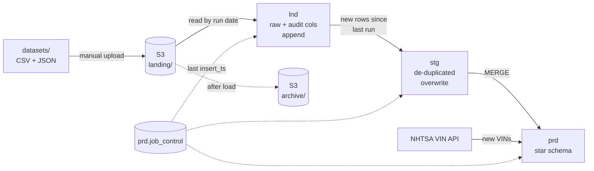
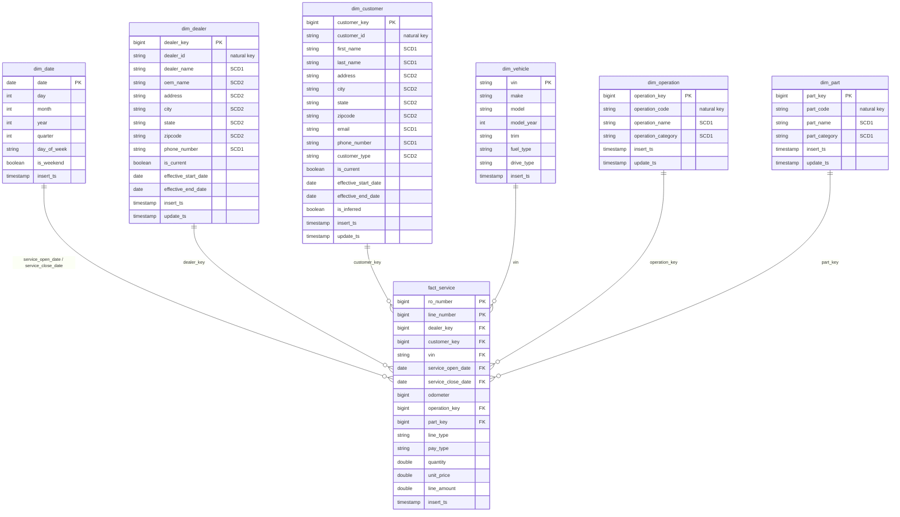

# PySpark Data Warehouse on AWS


An end-to-end batch data warehouse for automotive dealer service data, built with **PySpark**, **Delta Lake** and **Amazon S3**, with a **Hive metastore** on PostgreSQL, all running locally in **Docker**.

Raw CSV and JSON files land in S3 each week and move through three layers (landing → staging → production) into a star schema. Along the way the pipeline handles:

- **Slowly Changing Dimensions** (SCD Type 1 and Type 2 in the same table)
- **Early-arriving facts / late-arriving dimensions** (inferred members)
- **Unknown members** for optional foreign keys
- **Incremental loads** driven by a job-control table
- **Enrichment from a public API** (NHTSA VIN decoder for vehicle details)

---

## Table of contents

- [Tech stack](#tech-stack)
- [Architecture](#architecture)
- [Data model](#data-model)
- [Key concepts](#key-concepts)
- [Project structure](#project-structure)
- [Getting started](#getting-started)
- [Running the pipeline](#running-the-pipeline)
- [What each weekly run demonstrates](#what-each-weekly-run-demonstrates)
- [License](#license)

---

## Tech stack

| Area         | Technology                                             |
| ------------ | ------------------------------------------------------ |
| Processing   | PySpark 4.2, Python 3.12                               |
| Table format | Delta Lake 4.4 (MERGE, ACID writes)                    |
| Storage      | Amazon S3 (via `s3a://`, hadoop-aws 3.4.1, AWS SDK v2) |
| Catalog      | Hive metastore (schema 2.3.0) on PostgreSQL 16         |
| AWS access   | boto3 (landing file checks and archiving)              |
| External API | NHTSA vPIC VIN decoder                                 |
| Environment  | Docker, Docker Compose, JupyterLab, OpenJDK 17         |

---

## Architecture



| Layer      | Schema | What happens                                                                                                                                                | Write mode     |
| ---------- | ------ | ----------------------------------------------------------------------------------------------------------------------------------------------------------- | -------------- |
| Landing    | `lnd`  | File for the run date is read from S3, audit columns (`insert_ts`, plus `run_date` for dealer and customer) are added, then the file is moved to `archive/` | Append         |
| Staging    | `stg`  | Only rows newer than the last staging run are picked up, then de-duplicated on the natural key                                                              | Overwrite      |
| Production | `prd`  | Dimensions are MERGEd (SCD1/SCD2), surrogate keys assigned, the fact is loaded with dimension keys                                                          | Merge / append |

All tables are Delta tables registered in the Hive metastore. Their data lives in S3 under `warehouse/`.

---

## Data model

The production layer is a star schema with one fact table at the **repair-order line** grain (`ro_number` + `line_number`).



`prd.job_control` sits outside the star schema. It logs every load (`schema_name`, `table_name`, `insert_ts`, `run_date`) and drives the incremental logic.

---

## Key concepts

### Slowly Changing Dimensions (SCD)

`dim_dealer` and `dim_customer` mix **Type 1** and **Type 2** columns, handled in a single Delta `MERGE`:

- **Type 2** columns (e.g. address, OEM, customer type) keep history. When one changes, the current row is closed (`is_current = false`, `effective_end_date = run date - 1`) and a new current row is inserted with a new surrogate key.
- **Type 1** columns (e.g. name, phone, email) are overwritten in place, across all versions of that record, so corrections apply to history too.

The merge uses the _null merge-key_ technique: each incoming row is sent twice, once to match and update existing versions, and once with a null key so it falls through to the insert clause when a new version is needed. New surrogate keys are assigned as `max(existing key) + row_number()`, so they stay contiguous.

`dim_operation` and `dim_part` are **Type 1** only. `dim_vehicle` is insert-only and `dim_date` is generated once (1900–2100).

| Dimension       | Type 1 columns                             | Type 2 columns                               |
| --------------- | ------------------------------------------ | -------------------------------------------- |
| `dim_dealer`    | dealer_name, phone_number                  | oem_name, address, city, state, zipcode      |
| `dim_customer`  | first_name, last_name, email, phone_number | address, city, state, zipcode, customer_type |
| `dim_operation` | operation_name, operation_category         | –                                            |
| `dim_part`      | part_name, part_category                   | –                                            |

### Early-arriving facts / late-arriving dimensions

A service record can reference a customer that has not arrived in any customer file yet. Instead of dropping the fact or loading a null key:

1. While loading `fact_service`, any `customer_id` with no current row in `dim_customer` gets an **inferred member**: a placeholder row with a new `customer_key`, null attributes and `is_inferred = true`.
2. The fact row is loaded with that key straight away.
3. When the customer finally arrives, the customer load fills in the placeholder **in place** and sets `is_inferred = false`. The `customer_key` doesn't change, so facts already loaded stay correctly linked.

### Unknown members

Each repair-order line is either labour (has an operation) or a part (has a part code), so one of the two is always empty. Rather than null foreign keys, `dim_operation` and `dim_part` each have an **unknown member** (`key = -1`, code `N/A`), and empty codes in the fact are mapped to it.

### VIN enrichment from an API

`dim_vehicle` isn't fed by a file. After the fact load, any VIN in `fact_service` that isn't in `dim_vehicle` yet is sent to the [NHTSA vPIC VIN decoder API](https://vpic.nhtsa.dot.gov/api/). The response (one row per attribute) is pivoted into make, model, model year, trim, fuel type and drive type, then appended. A VIN that fails to decode is simply picked up again on the next run.

### Incremental loads with job control

Every notebook writes a row to `prd.job_control` when it finishes. Staging reads only landing rows with `insert_ts` later than its own last successful run, so each layer processes just what's new.

---

## Project structure

```
pyspark-dw-aws/
├── .aws.example/             # template for AWS credentials (copy to .aws/)
├── config_files/
│   ├── hive-site.xml         # Hive metastore -> Postgres connection
│   └── spark-defaults.conf   # Delta, S3A and Hive settings
├── datasets/                 # sample source files, one per entity per week
│   ├── customer/  dealer/  operation/  part/  service/
├── metastore-init/
│   └── 01-hive-schema.sql    # Hive 2.3.0 metastore schema, loaded on first Postgres start
├── notebooks/
│   ├── 00_run_date.json      # run date the pipeline processes
│   ├── 01_initialize_db      # create lnd/stg/prd databases and prd tables
│   ├── 02_Date_Production    # generate dim_date
│   ├── 03-05_Dealer_*        # Dimension load - landing / staging / production
│   ├── 06-08_Customer_*
│   ├── 09-11_Operation_*
│   ├── 12-14_Part_*
│   ├── 15-17_Service_*       # fact load, including inferred customers
│   ├── 18_Vehicle_Production # VIN decoding via NHTSA API
│   ├── 99_01-99_04_Execute   # orchestration notebooks (run these)
│   └── lib/                  # shared helpers (S3, job control, run date)
├── .env.example              # template for S3_BUCKET_NAME (copy to .env)
├── docker-compose.yml
├── Dockerfile
├── requirements.txt
└── LICENSE
```

---

## Getting started

### Prerequisites

- [Docker Desktop](https://www.docker.com/products/docker-desktop/) (or Docker Engine with Compose v2)
- [Git](https://git-scm.com/)
- An AWS account
- Optional: the [AWS CLI](https://aws.amazon.com/cli/) for uploading the sample data

### 1. Clone the repo

```bash
git clone https://github.com/acnaveen/pyspark-dw-aws.git
cd pyspark-dw-aws
```

### 2. Create an S3 bucket

Create a bucket in the AWS console (or with the CLI). Bucket names must be **globally unique**, 3–63 characters, lowercase letters, numbers, dots and hyphens only, so pick something like `yourname-pyspark-dw`.

```bash
aws s3 mb s3://<your-bucket-name> --region <your-region>
```

Note the region; you'll need it in step 4.

### 3. Create an IAM user and access key

Create an IAM user with programmatic access and attach a policy limited to your bucket:

```json
{
  "Version": "2012-10-17",
  "Statement": [
    {
      "Effect": "Allow",
      "Action": [
        "s3:ListBucket",
        "s3:GetBucketLocation",
        "s3:ListBucketMultipartUploads"
      ],
      "Resource": "arn:aws:s3:::<your-bucket-name>"
    },
    {
      "Effect": "Allow",
      "Action": [
        "s3:GetObject",
        "s3:PutObject",
        "s3:DeleteObject",
        "s3:AbortMultipartUpload"
      ],
      "Resource": "arn:aws:s3:::<your-bucket-name>/*"
    }
  ]
}
```

Then create an access key for the user.

### 4. Add your AWS credentials and bucket name

Copy the two templates:

```bash
# macOS / Linux / Git Bash
cp -r .aws.example .aws
cp .env.example .env
```

```powershell
# Windows PowerShell
Copy-Item .aws.example .aws -Recurse
Copy-Item .env.example .env
```

Then fill them in:

- `.aws/config`: set `region` to your bucket's region.
- `.aws/credentials`: paste your access key ID and secret access key.
- `.env`: set `S3_BUCKET_NAME` to your bucket name.

`.aws/` and `.env` are in `.gitignore`, so your keys are never committed. They're also kept out of the Docker image; `.aws` is mounted read-only into the container at runtime.

### 5. Upload the sample data to S3

Everything lives under a `pyspark-dw-aws/` prefix in your bucket:

```
s3://<your-bucket-name>/pyspark-dw-aws/
├── landing/        # incoming files, one subfolder per entity  <- you upload here
│   ├── customer/
│   ├── dealer/
│   ├── operation/
│   ├── part/
│   └── service/
├── archive/        # files are moved here after they're loaded (created automatically)
└── warehouse/      # Delta tables for lnd/stg/prd (created automatically by Spark)
```

Only `landing/` needs uploading. The subfolder names must match the folders in `datasets/`. Upload **all weeks at once**; each run only picks up the files for its own run date.

With the AWS CLI:

```bash
aws s3 cp datasets/ s3://<your-bucket-name>/pyspark-dw-aws/landing/ --recursive
```

Or in the S3 console: create the `pyspark-dw-aws/landing/` folder, then drag the five folders from `datasets/` into it.

### 6. Build and start the containers

```bash
docker compose up -d --build
```

This starts two containers:

| Container             | Purpose                                                                                                        | Port                                                    |
| --------------------- | -------------------------------------------------------------------------------------------------------------- | ------------------------------------------------------- |
| `metastore-db`        | PostgreSQL holding the Hive metastore. The schema in `metastore-init/` is loaded automatically on first start. | internal only                                           |
| `pyspark-jupyter-lab` | JupyterLab with PySpark, Delta Lake and the S3 connector                                                       | `127.0.0.1:8888` (Jupyter), `127.0.0.1:4040` (Spark UI) |

The first Spark session after each container start takes a little longer, because Spark downloads the Delta and S3 connector jars from Maven.

### 7. Open JupyterLab

1. Go to <http://127.0.0.1:8888>.
2. Get the login token from the container logs. It's in the URL printed after `token=`:
   ```bash
   docker logs pyspark-jupyter-lab
   ```
   or
   ```bash
   docker exec pyspark-jupyter-lab jupyter server list
   ```
3. On the login page, paste the token and set a password. You'll use the password from then on.

> The password is stored inside the container. If the container is recreated (for example with `docker compose up --force-recreate` or after `docker compose down`), use the token again and set a new password.

---

## Running the pipeline

Open the `notebooks/` folder in JupyterLab. You only run the `99_*` notebooks; each one creates the Spark session and runs the individual notebooks in order with `%run`.

### Step 1: initialise the warehouse (once)

Run **`99_01_Execute.ipynb`**. It creates the `lnd`, `stg` and `prd` databases and production tables, and fills `dim_date`.

> `01_initialize_db` drops existing tables first, so running `99_01` again resets the warehouse.

### Step 2: run each week in order

Each weekly notebook checks `notebooks/00_run_date.json` and stops if the date doesn't match, so update the file before each run:

```json
{
  "rundate": "20261012"
}
```

| Order | Set `rundate` to | Run                   |
| ----- | ---------------- | --------------------- |
| 1     | `20261012`       | `99_02_Execute.ipynb` |
| 2     | `20261019`       | `99_03_Execute.ipynb` |
| 3     | `20261026`       | `99_04_Execute.ipynb` |

For each entity, the notebook checks whether a landing file exists for that date. If it does, it runs landing → staging → production; if not, it skips that entity. The vehicle step runs every time.

While a notebook is running you can follow the Spark jobs at <http://127.0.0.1:4040>.

### Querying the results

From any notebook with an active session:

```python
spark.sql("select * from prd.dim_customer order by customer_id, effective_start_date").show()
spark.sql("select * from prd.job_control order by insert_ts").show()
```

### Starting over

Loaded files are moved from `landing/` to `archive/`. To rerun from scratch, move the files back into `landing/` (or upload them again), then run `99_01` and the weekly notebooks again.

### Stopping

```bash
docker compose down        # stop containers, keep the metastore
docker compose down -v     # stop and also delete the metastore volume
```

If you delete the metastore volume, the Delta data in S3 remains but Spark no longer knows the tables exist. Run `99_01` to start fresh.

---

## What each weekly run demonstrates

| Run date       | Files                                      | What to look for                                                                                                                                                                                                                                                                                                                                                                             |
| -------------- | ------------------------------------------ | -------------------------------------------------------------------------------------------------------------------------------------------------------------------------------------------------------------------------------------------------------------------------------------------------------------------------------------------------------------------------------------------- |
| **2026-10-12** | dealer, customer, operation, part, service | Initial load: 10 dealers, 10 customers, operations and parts (with the `-1` unknown member), first service facts and 4 VINs decoded via the API                                                                                                                                                                                                                                              |
| **2026-10-19** | dealer, customer, service                  | **SCD2:** customer 1001 moves to San Diego, dealer 89012 changes from Kia to Hyundai, dealer 34567 relocates. **SCD1:** dealer 12345 gets a new phone number, customer 1003 changes last name. **New members:** dealer 22334, customers 1011 and 1012. **Early-arriving fact:** the service file references customer 1013, who isn't in any customer file yet, so an inferred row is created |
| **2026-10-26** | customer                                   | **Late-arriving dimension:** customer 1013 finally arrives and the inferred row is filled in, keeping the same `customer_key`                                                                                                                                                                                                                                                                |

---

## License

This project is licensed under the MIT License. See [LICENSE](LICENSE).
